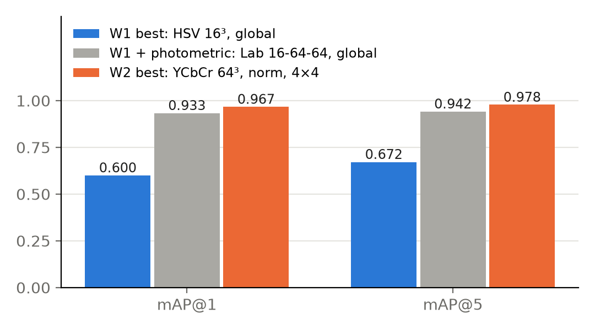
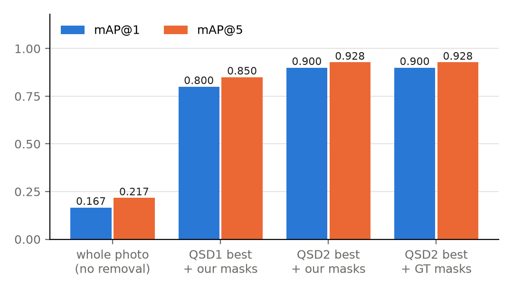
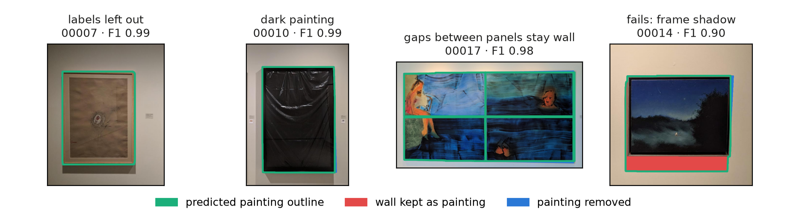

# Team 8 — Museum Painting Retrieval (C1)

Colour-histogram-based image retrieval for the UAB museum painting project (Weeks 1–2).

## Setup

```sh
python -m venv .venv
.venv\Scripts\activate        # Linux/macOS: source .venv/bin/activate
pip install -r requirements.txt
```

Extract the course datasets into `data/` (git-ignored): `data/BBDD/`, `data/qsd1_w1/` and `data/qsd2_w2/` (each with `gt_corresps.pkl`; QSD2 also has the ground-truth masks `<id>.png`), and the test sets `data/qst1_w2/` and `data/qst2_w2/` (from `qst_w2.zip`). **QSD1-W2 uses the same cropped images as QSD1-W1.** Run commands from the repository root.

## Best results

| Query set | Descriptor (exported configuration) | mAP@1 | mAP@5 |
|---|---|---|---|
| QSD1, Week 1 best | HSV 16-16-16, global, intersection (`results/week1/1d_none_best.json`) | 0.600 | 0.672 |
| QSD1, Week 2 best | YCbCr 64-64-64, photometric, 4×4 grid, L1 (`results/week2/qsd1_best_with_norm.json`) | 0.967 | 0.978 |
| QSD2, whole photo | QSD2 best descriptor without background removal | 0.167 | 0.217 |
| QSD2, Week 2 best | Lab 3D 16-16-8, photometric, 2×2 grid, L1, predicted masks (`results/week2/qsd2_best.json`) | 0.900 | 0.928 |

QSD2 background masks (default `foreground_mask`): mean precision 0.969, recall 0.985, F1 0.976 per image. Ground-truth masks give the same QSD2 retrieval scores as the predicted ones.

### Retrieval results

<p align="center">
  
  <br>
  <sub>Figure 1. Week 1 versus Week 2 retrieval performance on QSD1.</sub>
</p>

<p align="center">
  
  <br>
  <sub>Figure 2. Effect of background removal on QSD2 retrieval.</sub>
</p>


## Retrieval

```sh
# Run a descriptor and distance directly
python src/run_retrieval.py --descriptor hsv --measure l1

# Run a configuration selected during experiments
python src/run_retrieval.py --config results/week2/qsd1_best_with_norm.json --query-set qsd1

# QSD2: remove the wall and describe only the painting's pixels
python src/run_retrieval.py --config results/week2/qsd2_best.json --query-set qsd2_w2 --remove-background
```

- `--descriptor`: select a colour descriptor (listed below).
- `--measure`: `euclidean`, `l1`, `chi2`, `intersection`, `hellinger`, `wasserstein` (global 1D only).
- `--config`: load a configuration exported by `run_experiments.py`.
- `--query-set`, `--db-dir`, `--k`, `--output`: select the data and retrieval output.

Retrieval ranks database paintings by their similarity to each query. The output `.pkl` contains one ordered list of painting IDs per query.

## Colour descriptors

| Type | Descriptors | Description |
|---|---|---|
| **1D (Week 1)** | `hsv`, `hsv_baseline`, `rgb`, `lab`, `ycbcr` | Independent histograms for each colour channel |
| **2D (Week 2)** | `hsv_hs2d`, `lab_ab2d` | Joint H–S or a–b histograms, optionally including brightness |
| **3D (Week 2)** | `hsv_3d`, `lab_3d` | Joint histograms across three colour channels |

Histogram bins and other parameters are configurable through Python, JSON or CLI options.

### Photometric normalisation

Optional photometric normalisation supports `lab`, `ycbcr`, `lab_ab2d` and `lab_3d` in global, grid and pyramid layouts.
It centres each channel around 128 and scales all channels using the luminance standard deviation (target 50), then clips.
The transformation runs once per complete image, before spatial partitioning; histograms use the prepared float32 pixels.
The default `--normalization none` preserves existing values and caches; exported configurations retain the selected mode.
RGB/HSV remain unnormalised baselines.

```bash
python src/run_retrieval.py --descriptor lab_ab2d --normalization photometric --spatial-mode pyramid --grids 1 2 --measure l1
```

With `--remove-background`, Lab/YCbCr statistics and histogram counts use only foreground pixels; preparation runs once before trimming or partitioning. All four Lab/YCbCr families support masks with `none` or `photometric`; RGB keeps its existing mask support and HSV masks remain unsupported. Empty foreground masks raise an error.
Experiments also accept `--mask-source pred|gt`, `--trim-mode block|bbox` or `--no-trim`. GT masks are development diagnostics only. Database caches are reused; masked queries are never cached.
Masked CSVs and exported provenance record the mask source/trim policy and `replay_flags`; replay those flags explicitly with `run_retrieval.py --config` (loading the descriptor alone does not enable masking).

```sh
python src/run_experiments.py --config configs/week2/week2_qsd2_background_photometric.json --remove-background --mask-source pred --trim-mode block --cache-dir descriptors --output results/week2/qsd2_pred.csv --export-best results/week2/qsd2_pred_best.json
```

### Spatial histograms (Week 2)

- **`global`**: one descriptor for the entire image.
- **`grid`**: histograms from non-overlapping image blocks.
- **`pyramid`**: combine histograms at multiple spatial resolutions, with configurable level weights.

Select a representation using `--spatial-mode`, `--grids` and `--level-weights`. Background removal is handled separately from the cropped-image retrieval experiments.

## Background removal (Week 2)

`src/remove_background.py` estimates the wall colour from image borders and returns an original-resolution binary mask: **255 = painting, 0 = background**. It uses colour, connectivity and mask postprocessing without edge detection, contours or object detectors.

### Method

The default `color_distribution` method learns the wall’s Lab colour distribution from border pixels, accounting for brightness changes. Only wall-like regions connected to the image boundary are removed, preserving enclosed painting regions with similar colours.

Postprocessing closes gaps, removes small components, fills painting interiors and suppresses rows or columns with little foreground. The alternative `quadratic` method models spatial variations in wall colour using a quadratic surface.

### Segmentation examples



### Evaluate segmentation

Place development JPEG images and matching ground-truth PNG masks in `data/qsd2_w2/` (for example, `00001.jpg` and `00001.png`). Use `--gt` to select a separate mask directory if needed.

```sh
# Evaluate the colour-distribution model with the selected sigma
python src/evaluate_background.py --images data/qsd2_w2 --gt data/qsd2_w2 --method color_distribution --color-sigma 4.0 --output results/background_masks

# Search for the sigma with the highest mean F1
python src/evaluate_background.py --images data/qsd2_w2 --gt data/qsd2_w2 --method color_distribution --grid-search --output results/background_masks_sweep

# Evaluate the spatial quadratic baseline
python src/evaluate_background.py --images data/qsd2_w2 --gt data/qsd2_w2 --method quadratic --threshold 20 --output results/background_masks_quadratic
```

A single run saves masks in `<output>/masks/` and per-image precision, recall, F1 and pixel counts in `<output>/metrics.csv`. Printed scores are macro averages over images.

Grid search tests sigma values from 2 to 6 in steps of 0.5 for `color_distribution`, or thresholds 10, 15, 20 and 25 for `quadratic`. It saves masks under `<output>/threshold_<value>/masks/` and ranks configurations by mean F1 in `threshold_comparison.csv`.

The selected colour tolerance is `color_sigma=4.0`, which achieved the highest mean F1 on the development set. To use it consistently, set this default in both `foreground_mask()` and the evaluation CLI; grid search does not update retrieval automatically.

| Option | Purpose |
|---|---|
| `--color-sigma` | Colour-distribution tolerance; larger values classify more colours as wall |
| `--threshold`, `--mad-multiplier`, `--l-weight` | Quadratic model threshold, adaptive scale and lightness weight |
| `--border-ratio`, `--sample-step` | Border width fraction and sampling spacing |
| `--closing-size`, `--min-component-ratio` | Closing kernel size and minimum component area fraction |
| `--enclosed-only` | Disable horizontal and vertical span filling |
| `--no-fill-columns` | Disable vertical span filling only |
| `--no-fill-interior` | Disable interior refinement; row/column filtering still runs |
| `--min-row-foreground`, `--min-col-foreground` | Final foreground-fraction cutoffs; 0 disables an axis |

### Retrieval with foreground masks

Enable background removal explicitly, including when loading an exported configuration. Query descriptors then use only foreground pixels.

```sh
python src/run_retrieval.py --config results/week2/qsd2_best.json --query-set data/qsd2_w2 --remove-background --mask-source pred --trim-mode block
```

`--trim-mode block` removes background block rows and columns before spatial partitioning; `--trim-mode bbox` crops to the foreground bounding box, and `--no-trim` preserves the full image layout. `--save-masks DIR` saves original-resolution masks before trimming.

Ground-truth masks (`--mask-source gt`) are for development diagnostics only. QSD1/QST1 images are already cropped and do not require background removal.

## Week 2 delivery

```sh
# QST1: retrieve using the already cropped paintings
python src/run_retrieval.py --config results/week2/qsd1_best_with_norm.json --query-set data/qst1_w2 --no-gt --k 10 --output results/week2/QST1/method1/result.pkl

# QST2: retrieve using predicted foreground masks and export them
python src/run_retrieval.py --config results/week2/qsd2_best.json --query-set data/qst2_w2 --remove-background --mask-source pred --trim-mode block --no-gt --k 10 --output results/week2/QST2/method1/result.pkl --save-masks results/week2/QST2/method1
```

Each `result.pkl` contains one ranked list of 10 integer BBDD IDs per query, in query order. QST2 also includes one PNG mask per query, saved alongside `result.pkl` with the same basename (for example, `00001.jpg` → `00001.png`).

The output produces the following files:

- `Team8/week2/QST1/method1/result.pkl`
- `Team8/week2/QST2/method1/result.pkl`
- `Team8/week2/QST2/method1/*.png`


## Experiments

Use `src/run_experiments.py` to compare descriptors, distances and spatial representations. Experiments can be configured in three ways:

**Python / original grids** — edit `EXPERIMENTS` in `src/run_experiments.py`, or use the existing grids:

```sh
python src/run_experiments.py --grid default --output config_results/default.csv
python src/run_experiments.py --grid lab --output config_results/lab.csv
python src/run_experiments.py --grid ycbcr --output config_results/ycbcr.csv
python src/sweep_hsv.py --output config_results/hsv_sweep.csv
```

**JSON** — edit the experiment suites in `configs/week1/` and `configs/week2/`:

```sh
python src/run_experiments.py --config configs/week1/week1_1d_none.json --cache-dir descriptors --output results/week1/1d_none.csv --export-best results/week1/1d_none_best.json
python src/run_experiments.py --config configs/week1/week1_1d_photometric.json --cache-dir descriptors --output results/week1/1d_photometric.csv --export-best results/week1/1d_photometric_best.json
python src/run_experiments.py --config configs/week2/week2_joint_spatial_normalization.json --cache-dir descriptors --output results/week2/qsd1_pred_with_norm.csv --export-best results/week2/qsd1_best_with_norm.json
```

The example suites compare colour histograms, spatial layouts and pyramid weights. Their settings can be modified freely.

**CLI** — run an experiment directly without editing a configuration file:

```sh
python src/run_experiments.py --descriptor hsv_hs2d --spatial-mode grid --grids 2 --measures l1 chi2 hellinger --output results/week2/quick.csv
```

Use `--dry-run` to preview experiments, `--overwrite` to replace existing outputs and `-h` for more options. `--export-best` saves a configuration that can be reused with `run_retrieval.py`.

## Generating plots

Each script in `src/visualizations/` produces one figure in `plots/` (`--output` to change it; `-h` for options):

**Week 1**
- `plot_best_comparison.py`: all measures for the best configuration of each descriptor.
- `plot_hsv_histograms.py <id>` / `plot_hue_mask.py <id>`: per-image HSV histograms and Hue mask.
- `plot_results.py`, `plot_example_descriptors.py`: report figures.

**Week 2: descriptors (QSD1)**
- `plot_descriptor_types.py`: best global mAP@5 of each descriptor type, with and without photometric normalisation.
- `plot_block_grid_example.py`: a query split into a 4×4 grid and its concatenated descriptor.
- `plot_grid_size_sweep.py`: mAP@5 against the number of blocks per side.
- `plot_pyramid_vs_grid.py`: spatial pyramids against the grid of their finest level.
- `plot_week1_vs_week2.py`: Week 1 best, Week 1 with normalisation and Week 2 best.
- `plot_week1_vs_week2_example.py`: a query Week 1 misses and Week 2 finds, top 3 of each.

**Week 2: background removal and QSD2**
- `plot_mask_pipeline.py`: the background-removal steps on one query.
- `plot_wall_model.py`: the fitted wall colour against lightness.
- `plot_mask_examples.py`: predicted masks on harder queries, with errors against the ground truth.
- `plot_block_foreground.py`: foreground percentage per block of the grid.
- `plot_trim_limit.py`: retrieval and lost painting for each trim mode and limit.
- `plot_foreground_descriptor.py`: how a query descriptor uses the mask.
- `plot_qsd2_retrieval.py`: QSD2 mAP without removal, with predicted masks and with GT masks.
- `plot_qsd2_failures.py`: the QSD2 queries wrong at rank 1.
