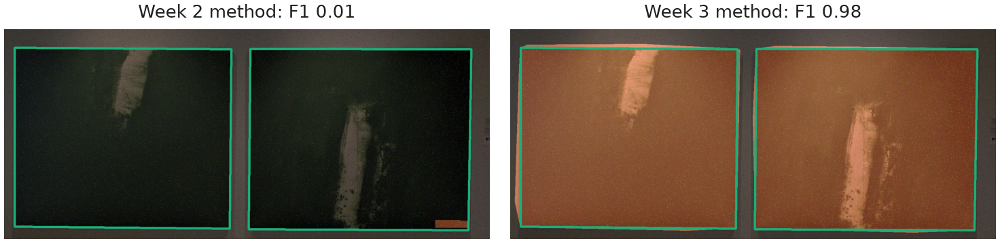
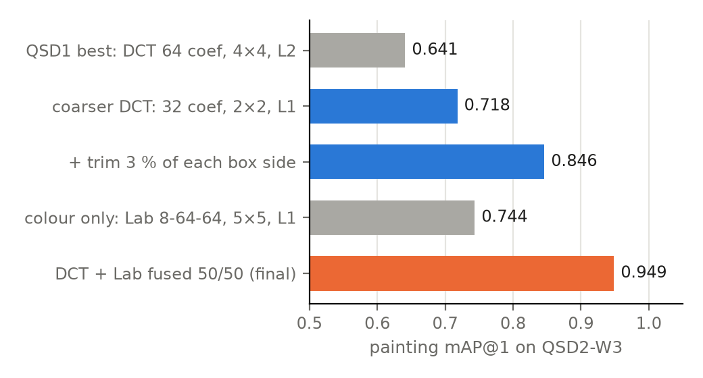

# Team 8 — Museum Painting Retrieval (C1)

Colour and texture retrieval for the UAB museum painting project. This branch focuses on **Week 3: noise filtering, texture descriptors, multiple-painting detection and retrieval**.

## Setup

```sh
python -m venv .venv
.venv\Scripts\activate
# Linux/macOS: source .venv/bin/activate
pip install -r requirements.txt
```

Run commands from the repository root. Extract datasets into `data/` (git-ignored):

| Folder | Contents |
|---|---|
| `data/BBDD/` | Database painting images |
| `data/qsd1_w3/` | Cropped development queries and `gt_corresps.pkl` |
| `data/qsd2_w3/` | Multi-painting development queries, `gt_corresps.pkl` and `frames.pkl` |
| `data/qst1_w3/`, `data/qst2_w3/` | Blind-test query images |

Only JPEGs are read as query images. QSD2 development frame annotations must follow the correspondence order. Database descriptors are cached in `descriptors/`; the first run computes missing caches.

## Previous work: Weeks 1–2

Week 1 introduced global colour histograms and distance comparisons. Week 2 added joint colour histograms, photometric normalisation, spatial grids/pyramids and colour-based background removal. The wall model estimates Lab colour statistics from border pixels and removes wall-like regions connected to the boundary, followed by morphological cleanup and hole filling.

| Selected development result | Method | mAP@1 | mAP@5 |
|---|---|---|---|
| Week 1, QSD1 | Global HSV, intersection | 0.600 | 0.672 |
| Week 2, QSD1 | YCbCr, photometric normalisation, 4×4 grid, L1 | 0.967 | 0.978 |
| Week 2, QSD2 | Lab 3D, photometric normalisation, 2×2 grid, L1, predicted masks | 0.900 | 0.928 |

Week 2 QSD2 segmentation reached mean F1 **0.9759**. Earlier configurations and results remain in `configs/week1/`, `configs/week2/`, `results/week1/` and `results/week2/`. Different weeks use different query sets, so these scores are not a controlled comparison across weeks.

## Week 3: noise, texture and multiple paintings

### Noise filtering and texture descriptors

`src/filter_noise.py` provides query filtering, including a selective median policy that filters only crops whose noise score exceeds a threshold. Filtering is applied to queries; database paintings retain their original pixels. The selected QSD2 export uses a 3×3 median filter with `noise_threshold=6.0`. Its provenance notes that this policy ties the unfiltered model on the development sets; it was retained for a consistent pipeline. The selected QSD1 export uses no filtering.

The Week 3 texture descriptors are `dct`, `wavelet`, `lbp` and `multiscale_lbp`. DCT represents spatial frequency content, wavelets describe information at several scales, and LBP variants encode local intensity patterns. Spatial grids preserve their approximate locations within the painting.

The saved texture comparison (`results/week3/texture/summary.json`) reports:

| Best configuration per family on QSD1-W3 | Distance | mAP@1 | mAP@5 |
|---|---|---|---|
| DCT, 128 coefficients, 2×2 grid | L1 | 1.0000 | 1.0000 |
| LBP, radius 2, 4×4 grid | L1 | 0.9667 | 0.9833 |
| Multiscale LBP, uniform mapping, radii 1–3, 4×4 grid | Chi-square | 0.9333 | 0.9556 |
| Haar wavelet, level 4, 4×4 grid | Euclidean | 0.6667 | 0.7089 |

Several DCT configurations reach perfect development retrieval. The separately exported QST1 configuration is **DCT with 64 coefficients, resize 256, 4×4 grid and Euclidean distance**, which also reaches 1.0000 mAP@1 and mAP@5. These are development results, not blind-test accuracy.

### Detecting multiple paintings

`src/painting_detection.py` separates up to two painting instances using the configuration in `configs/week3/task3_selected.json`. It builds on the border-conditioned Lab wall model, uses `color_sigma=3.0` and a robust dark-wall cutoff, disables the final row/column foreground cleanup, groups fragments and refines instance masks with convex hulls. Instances are returned in reading order.

Retrieval describes rectangular crops from the **original image pixels**, rather than black-masked images. The selected retrieval configuration then trims 3% from each crop side to reduce frame/background contamination. Submitted masks remain at the original query resolution.

On QSD2-W3, the saved segmentation comparison gives:

| Segmentation method on QSD2-W3 | Mean precision | Mean recall | Mean F1 | Correct painting count |
|---|---|---|---|---|
| Week 2 method | 0.9888 | 0.6317 | 0.6777 | 22/30 |
| Week 3 method | 0.9434 | 0.9832 | 0.9608 | 30/30 |

The Week 3 method recovers substantially more painting pixels, with some reduction in precision. It correctly counts all 21 single-painting and 9 two-painting development images. This configuration is specialised for Week 3: on QSD2-W2 its mean F1 is 0.9444, compared with 0.9759 for the Week 2 method.

<p align="center">
  
  <br>
  <sub>Week 2 and Week 3 segmentation on the development sets.</sub>
</p>

### QSD2 retrieval and descriptor fusion

The selected pipeline combines **DCT with 32 coefficients, resize 256, 2×2 grid, L1** and **Lab histograms with bins [8, 64, 64], 5×5 grid, L1**. Distances are standardised per query before a 50/50 weighted sum, so the two descriptor scales are comparable. Both descriptors see the same filtered painting crop.

The saved QSD2-W3 ablation (`results/week3/retrieval/summary.json`) shows:

| Configuration | Painting mAP@1 | Painting mAP@5 |
|---|---|---|
| QSD1-selected DCT: 64 coefficients, 4×4 grid, Euclidean | 0.6410 | 0.6966 |
| Coarser DCT: 32 coefficients, 2×2 grid, L1 | 0.7179 | 0.7795 |
| Coarser DCT + 3% crop inset | 0.8462 | 0.8803 |
| Colour-only Lab: bins [8, 64, 64], 5×5 grid, L1 | 0.7436 | 0.7628 |
| Final DCT + Lab fusion | **0.9487** | **0.9487** |

Crop trimming improves retrieval by reducing border contamination; fusion improves the observed scores further by combining colour and texture evidence. The final result corresponds to 37 of 39 paintings retrieved correctly at rank 1. The two remaining correct matches are also absent from the top 5, explaining the identical mAP values. Perfect painting counts therefore do not imply perfect identification.

<p align="center">
  
  <br>
  <sub>Effect of descriptor selection, crop trimming and fusion on QSD2-W3 retrieval.</sub>
</p>

### Evaluate the selected configurations

Run from the repository root:

```sh
# QSD1-W3: selected single-painting descriptor
python src/run_retrieval.py --config results/week3/week3_100_best.json --query-dir data/qsd1_w3 --db-dir data/BBDD

# QSD2-W3: complete multi-painting pipeline and geometric GT matching
python src/run_retrieval.py --config results/week3/qsd2_best.json --query-dir data/qsd2_w3 --db-dir data/BBDD --multi-painting --segmentation-config configs/week3/task3_selected.json --gt data/qsd2_w3/gt_corresps.pkl --gt-frames data/qsd2_w3/frames.pkl --k 10 --output results/week3/qsd2_evaluation/result.pkl --diagnostics results/week3/qsd2_evaluation/diagnostics.json
```

`run_retrieval.py` loads the descriptor, distance and saved filtering policy. For the QSD2 export, it also restores the crop inset and fusion settings. `--multi-painting` and `--segmentation-config` must be supplied together; do not combine them with legacy `--remove-background`. Ground-truth frames are used only to match predictions geometrically for evaluation, not to detect paintings or rank database images.

**Exported best configurations and experiment suites are different formats.** Evaluate `results/week3/qsd2_best.json` with `run_retrieval.py`; passing it to `run_experiments.py` produces an unknown-suite-settings error. To repeat the multi-painting search instead:

```sh
python src/search_multi.py --config configs/week3/qsd2_search.json --output results/week3/qsd2_search_rerun.csv --export-best results/week3/qsd2_best_rerun.json
```

The search suite uses median threshold 5.0; the selected export uses 6.0. Evaluate the export to replay the reported pipeline.

## Week 3 delivery (Task 5)

Place blind-test JPEGs in `data/qst1_w3/` and `data/qst2_w3/`. No test ground truth is required:

```sh
# QST1: already cropped paintings, with the required extra list level
python src/run_retrieval.py --config results/week3/week3_100_best.json --query-dir data/qst1_w3 --db-dir data/BBDD --nested-output --no-gt --k 10 --output results/week3/QST1/method1/result.pkl

# QST2: detect each painting, retrieve, and save one union mask per query
python src/run_retrieval.py --config results/week3/qsd2_best.json --query-dir data/qst2_w3 --db-dir data/BBDD --multi-painting --segmentation-config configs/week3/task3_selected.json --no-gt --k 10 --output results/week3/QST2/method1/result.pkl --save-masks results/week3/QST2/method1
```

Both pickle files use **query image → painting → 10 ranked integer database IDs**. The first ID is the best match, not a confidence score. QST1 uses `--nested-output`; QST2 obtains the extra list level automatically through `--multi-painting`.

Query order follows sorted image IDs; painting order follows the detector's reading order. Masks are original-resolution binary PNGs: **255 = painting, 0 = background**, named like their queries (`00001.jpg` → `00001.png`).

The generated submission files are placed in the course GDrive folder as:

- `Team8/week3/QST1/method1/result.pkl`
- `Team8/week3/QST2/method1/result.pkl`
- `Team8/week3/QST2/method1/*.png`

The QST1 results contain 50 images, each with one painting. The QST2 results contain 30 images with 40 detected paintings in total: 20 images have one painting and 10 have two. Each painting has a ranked list of 10 database image IDs, with no duplicates. QST2 also requires one segmentation mask per image (30 PNG files).

A `.manifest.json` is generated alongside each Week 3 pickle for reproducibility; it is additional metadata. Existing result, mask or report files are not overwritten: move previous outputs or choose a new destination before rerunning.

