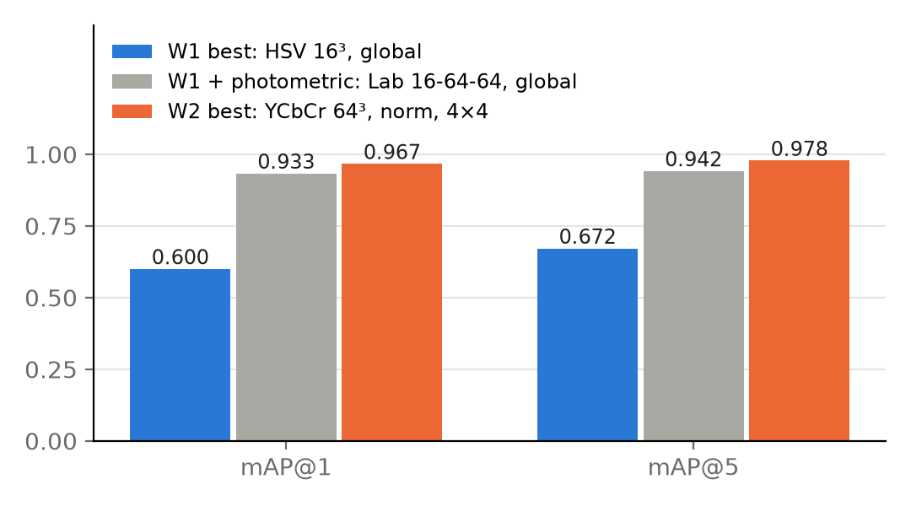
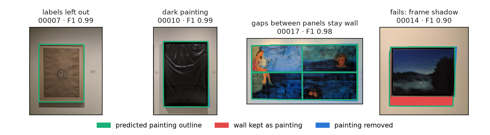
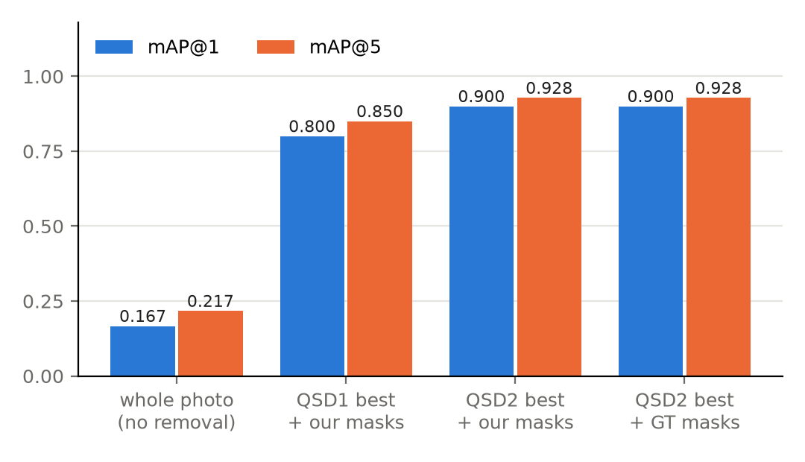
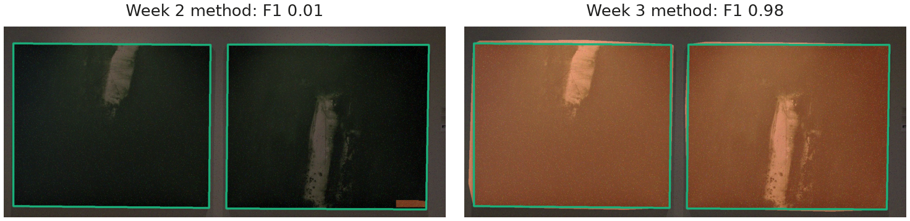
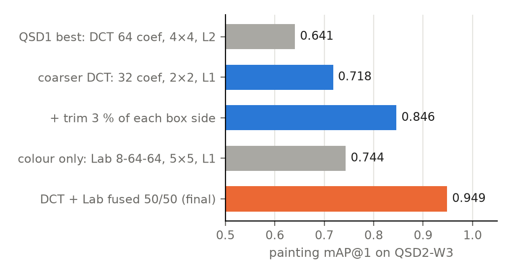
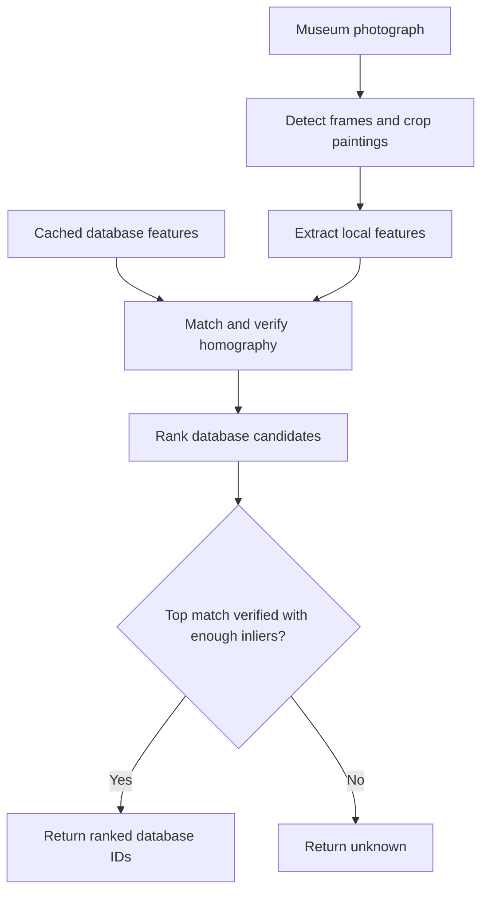

# Team 8 — Museum Painting Retrieval (C1)

Given a museum photograph, the system locates up to two paintings, crops each one and ranks matching paintings from the museum database (BBDD). Weeks 1–3 developed global colour and texture baselines. Week 4 adds local feature matching, geometric verification and rejection of paintings absent from the database.

## Setup

From the repository root, create and activate a virtual environment, then install the dependencies.

```sh
python -m venv .venv
source .venv/bin/activate  # Windows PowerShell uses .venv\Scripts\Activate.ps1
python -m pip install -r requirements.txt
```

Extract the course datasets into the git-ignored `data/` directory. Query images are JPEGs. Database features are computed on the first run and cached under `descriptors/`.

| Folder | Contents |
|---|---|
| `data/BBDD/` | Reference painting images |
| `data/qsd1_w4/` | Week 4 development queries, `gt_corresps.pkl` and `frames.pkl` |
| `data/qst1_w4/` | Week 4 blind test set of 30 museum photos with visible backgrounds. Some photos contain multiple paintings, and some paintings have noise or colour changes. |
| `data/qsd1_w1/`, `data/qsd1_w3/` | Earlier cropped development queries and correspondence labels |
| `data/qsd2_w2/` | Museum photos with one painting each, ground-truth foreground masks (PNG), and matching database IDs (`gt_corresps.pkl`) |
| `data/qsd2_w3/` | Museum photos with one or two paintings, ground-truth foreground masks (PNG), matching database IDs (`gt_corresps.pkl`), and painting frame coordinates (`frames.pkl`) |

## Weeks 1–3 · Global retrieval

### Week 1 · Colour histograms

We represented each painting with one normalised histogram per colour channel and compared RGB, HSV, YCbCr and Lab. We tested L1, Euclidean, chi-square, histogram intersection, Hellinger and Wasserstein distances. The HSV descriptor excludes dark and low-saturation pixels from the hue histogram, where hue is less informative. Global HSV with histogram intersection was the strongest baseline without photometric normalisation. A separate sweep with normalisation selected global Lab on the same queries.

<p align="center">
  
  <br>
  <sub>Global colour baselines and the Week 2 spatial model evaluated on the same QSD1-W1 queries.</sub>
</p>

### Week 2 · Spatial colour and background removal

We added joint colour histograms, photometric normalisation, and spatial grids and pyramids. Computing histograms per block preserves coarse layout, so paintings with similar overall colours can still be distinguished by where those colours appear.

For museum photographs, we estimated the wall's Lab colour distribution from border pixels. We removed wall-like regions connected to the image boundary, then cleaned and filled the foreground mask. The retrieval descriptor used the predicted foreground pixels. On QSD2-W2, the same spatial Lab configuration went from **0.167** mAP@1 on whole photos to **0.900** with predicted masks.

<p align="center">
  
  <br>
  <sub>Examples of Week 2 foreground segmentation on museum photographs.</sub>
</p>

<p align="center">
  
  <br>
  <sub>Effect of background removal on QSD2-W2 retrieval.</sub>
</p>

### Week 3 · Texture, noise and multiple paintings

We compared DCT coefficients for spatial frequencies, Haar wavelets for multiscale detail, and LBP variants for local intensity patterns. We also evaluated selective median filtering on query crops. DCT reached **1.0000** mAP@1 and mAP@5 on QSD1-W3. The selected QSD2 pipeline uses a 3×3 median filter only when the crop's noise score exceeds 6.0. This policy tied the unfiltered pipeline on the development data.

For photos containing up to two paintings, we adapted the wall model, grouped foreground fragments and refined each instance mask with a convex hull. On QSD2-W3, the Week 3 detector recovered more painting pixels and counted the paintings correctly in all 30 photos. The Week 2 method retained higher precision on those photos.

<p align="center">
  
  <br>
  <sub>Week 2 and Week 3 segmentation on a challenging two-painting photo from QSD2-W3.</sub>
</p>

We cropped each detection from the original photograph and trimmed 3% from each side to reduce frame and wall pixels. The final QSD2 model fused DCT (32 coefficients, 2×2 grid, L1) with Lab (8–64–64 bins, 5×5 grid, L1). The two distances were standardised per query and averaged with equal weights. The fused model ranked the correct database image first for **37 of 39** paintings. The two misses were also outside the top five.

<p align="center">
  
  <br>
  <sub>QSD2-W3 retrieval ablation comparing descriptor choice, crop trimming and fusion.</sub>
</p>

## Development results at a glance

The retrieval table groups comparisons by dataset. QSD1-W1 was reused for the Week 2 spatial colour experiments. QSD1-W3, QSD2-W3 and QSD1-W4 contain different queries, and the Week 4 overall metric also includes paintings absent from BBDD.

| Week | Dataset | Configuration | mAP@1 | mAP@5 |
|---|---|---|---:|---:|
| 1 | QSD1-W1 | Global HSV, intersection | 0.6000 | 0.6717 |
| 1 | QSD1-W1 | Global Lab, photometric normalisation, intersection | 0.9333 | 0.9417 |
| 2 | QSD1-W1 | Spatial Lab, 5×5 grid, without photometric normalisation, L1 | 0.8333 | 0.8733 |
| 2 | QSD1-W1 | Spatial YCbCr, 4×4 grid, photometric normalisation, L1 | **0.9667** | **0.9778** |
| 2 | QSD2-W2 | Spatial Lab 3D on whole photos | 0.1667 | 0.2167 |
| 2 | QSD2-W2 | Spatial Lab 3D with predicted masks | **0.9000** | **0.9278** |
| 2 | QSD2-W2 | Same configuration with ground-truth masks | 0.9000 | 0.9278 |
| 3 | QSD1-W3 | DCT, 128 coefficients, 2×2 grid, L1 | **1.0000** | **1.0000** |
| 3 | QSD1-W3 | LBP, radius 2, 4×4 grid, L1 | 0.9667 | 0.9833 |
| 3 | QSD1-W3 | Multiscale LBP, uniform mapping, radii 1–3, 4×4 grid, chi-square | 0.9333 | 0.9556 |
| 3 | QSD1-W3 | Haar wavelet, level 4, 4×4 grid, Euclidean | 0.6667 | 0.7089 |
| 3 | QSD2-W3 | DCT selected on QSD1, 64 coefficients, 4×4 grid, Euclidean | 0.6410 | 0.6966 |
| 3 | QSD2-W3 | Coarser DCT, 32 coefficients, 2×2 grid, L1 | 0.7179 | 0.7795 |
| 3 | QSD2-W3 | Coarser DCT + 3% crop inset | 0.8462 | 0.8803 |
| 3 | QSD2-W3 | Lab only, 5×5 grid, L1 | 0.7436 | 0.7628 |
| 3 | QSD2-W3 | Final DCT + Lab fusion | **0.9487** | **0.9487** |
| 4 | QSD1-W4 | Local features, geometric verification and unknown rejection | — | — |

The Week 4 experiment runner writes the scores to `summary.json` and `results.csv`. The repository tracks the experiment configurations.

| Segmentation dataset | Method | Mean precision | Mean recall | Mean F1 | Correct painting count |
|---|---|---:|---:|---:|---:|
| QSD2-W2 | Week 2 wall model | 0.9687 | 0.9845 | **0.9759** | 28/30 |
| QSD2-W2 | Week 3 instance detector | 0.8992 | 0.9994 | 0.9444 | 28/30 |
| QSD2-W3 | Week 2 wall model | 0.9888 | 0.6317 | 0.6777 | 22/30 |
| QSD2-W3 | Week 3 instance detector | 0.9434 | 0.9832 | **0.9608** | **30/30** |

The underlying results are in [Week 1](results/week1/), [Week 2](results/week2/) and the Week 3 [texture](results/week3/texture/summary.json), [retrieval](results/week3/retrieval/summary.json) and [mask](results/week3/masks/summary.json) summaries. The archived READMEs contain the original evaluation and submission commands for [Week 1](https://github.com/MCV-2026-C1-Project/Team8/tree/week_1), [Week 2](https://github.com/MCV-2026-C1-Project/Team8/tree/week_2) and [Week 3](https://github.com/MCV-2026-C1-Project/Team8/tree/week_3).

## Week 4 · Local feature retrieval

Global descriptors compare the overall distribution of colour and texture. Week 4 instead looks for corresponding points and checks whether those points agree with a single geometric transformation. This gives the system a way to handle changes in viewpoint and to reject a query painting when the best match has weak geometric evidence.



### 1. Detect paintings and prepare crops

[src/painting_detection.py](src/painting_detection.py) starts with the border-based Lab wall model. A conditional morphological opening can split foreground regions joined by thin bridges, and a separate merge step combines overlapping fragments.

The detector also proposes frames from **Canny edges at four Gaussian scales**. It closes small gaps, approximates contours as convex quadrilaterals, and checks that all four sides have support in the edge map before closing. The proposals are checked against colour foreground evidence. A supported frame can complete a partial mask, split a merged detection or recover a frame missed by the colour stage. The detector returns up to two instances in reading order, with masks at the original resolution.

Retrieval extracts rectangular crops from the original image and trims **3%** from each side in the baseline configuration. The noise comparison suite tests unfiltered crops against a selective **3×3 median filter** that runs only when the crop's noise score exceeds 6.0.

### 2. Extract and match local features

[src/local_features.py](src/local_features.py) extracts grayscale keypoints and descriptors from each query crop and reference painting. Each crop is compared against the full database using the same feature family on both sides.

| Feature family | Descriptor type | Brute-force distance |
|---|---|---|
| SIFT | Floating-point | L2 |
| ORB | Binary | Hamming |
| AKAZE | Binary | Hamming |

[src/local_matching.py](src/local_matching.py) finds the two nearest database descriptors for each query descriptor. The ratio test keeps a match when the closest descriptor is sufficiently closer than the second closest. The optional mutual check additionally requires the matched database descriptor to select the same query descriptor as its nearest neighbour in the reverse direction.

### 3. Verify geometry and rank candidates

[src/local_geometry.py](src/local_geometry.py) estimates a **query-to-database homography** with RANSAC or USAC/MAGSAC. Correspondences consistent with that homography are inliers. The reprojection threshold is measured in normalised database pixels using a reference long side of 1000 pixels by default.

[src/local_retrieval.py](src/local_retrieval.py) ranks candidates by either the **inlier count** or a **coverage-weighted score**. The latter multiplies the count by the geometric mean of the fractions of occupied grid cells in the query and database images. With the default 4×4 grids, this favours inliers spread across the painting over inliers clustered in a small patch.

### 4. Reject paintings absent from BBDD

[src/local_rejection.py](src/local_rejection.py) checks the top-ranked candidate. It outputs `[-1]` if geometric verification fails or if the candidate has fewer inliers than the configured minimum. Otherwise it returns the ranked database IDs. The development runner selects the minimum inlier count that maximises unknown-class F1 on geometrically aligned paintings, breaking ties in favour of the smaller threshold.

### Development experiments and evaluation

| Configuration | What it compares |
|---|---|
| [Baseline](configs/week4/local_matching_baseline.json) | SIFT, brute-force ratio matching at 0.75, RANSAC at 3.0 normalised pixels and ranking by inlier count. |
| [Essential grid](configs/week4/week4_essential.json) | SIFT, ORB and AKAZE across two match filters, two homography estimators and two scoring modes. |
| [Extended grid](configs/week4/week4_extended.json) | The same comparisons with additional ratio and reprojection thresholds. |
| [Noise comparison](configs/week4/week4_noise_comparison.json) | Unfiltered versus selectively median-filtered query crops for each feature family and scoring mode. |

The runner matches detection boxes to annotated frames using one-to-one geometric alignment at IoU ≥ 0.5. It reports mAP@1 and mAP@5 for known paintings before and after rejection, and overall mAP including unknown paintings. A missed painting contributes zero to overall mAP. The detection-aware variant also penalises extra detections. Unknown precision, recall and F1 are calculated on aligned paintings only.

The runner selects configurations by overall mAP@1, then unknown F1, then overall mAP@5. Both model selection and threshold tuning use QSD1-W4 development labels. The scores therefore describe development performance.

### Run Week 4

```sh
# List the experiment configurations without loading the datasets
python src/run_local_experiments.py --config configs/week4/week4_essential.json --dry-run

# Evaluate the full development set and optionally include the Week 3 baseline
python src/run_local_experiments.py \
  --config configs/week4/week4_essential.json \
  --query-dir data/qsd1_w4 --db-dir data/BBDD \
  --output results/week4/essential \
  --week3-config results/week3/qsd2_best.json --diagnostics
```

Choose a new output directory for each run. It contains `results.csv` for configuration comparisons, `summary.json` for the selected metrics, `best_config.json` for the selected settings and `predictions.json` for per-query rankings. The optional baseline applies the exported Week 3 DCT + Lab ranking to the same development photos, using the detector in this checkout with Week 3 settings. Unknown rejection is disabled for this baseline. Its results are written separately to `week3_baseline.json`.

```sh
# Compare detected keypoints across feature families on two query photos
python src/inspect_local_features.py --method all --query-dir data/qsd1_w4 \
  --query-limit 2 --output results/week4/keypoint_examples

# Inspect matches, homography inliers and rejection for the selected configuration
python src/inspect_local_matching.py --config results/week4/essential/best_config.json \
  --query-dir data/qsd1_w4 --query-limit 2 --visualize-top 2 \
  --output results/week4/match_examples
```
